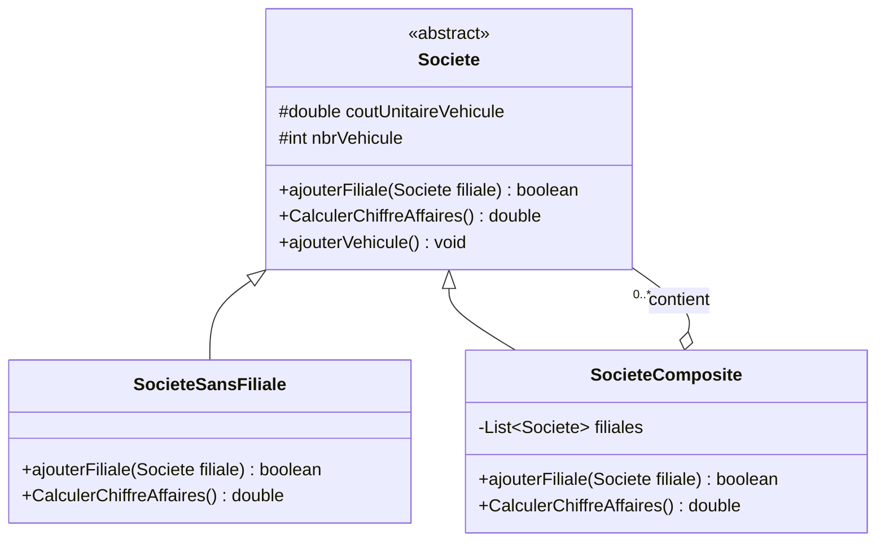

# Patron Composite

## Rôle du patron

Le patron de conception **Composite** permet de traiter de manière uniforme :

- des objets simples, appelés **feuilles** ;
- des groupes d’objets, appelés **composites**.

Dans cet exemple, une société peut être une société sans filiale ou un groupe
contenant plusieurs sociétés. Les deux types de sociétés utilisent la même
classe abstraite `Societe` et peuvent donc calculer leur chiffre d’affaires
avec la même méthode.

## Exemple traité

L’application représente des sociétés qui possèdent des véhicules.

- Chaque véhicule rapporte `5.0` unités de chiffre d’affaires.
- `SocieteSansFiliale` représente une société simple qui ne contient aucune
  filiale.
- `SocieteComposite` représente un groupe qui peut contenir plusieurs
  sociétés.
- Le chiffre d’affaires d’un groupe est la somme du chiffre d’affaires de ses
  filiales et de celui de ses propres véhicules.

## Architecture UML

### Correspondance avec le patron

| Élément du patron | Classe du projet |
|---|---|
| Component | `Societe` |
| Leaf | `SocieteSansFiliale` |
| Composite | `SocieteComposite` |
| Client | `App` |
